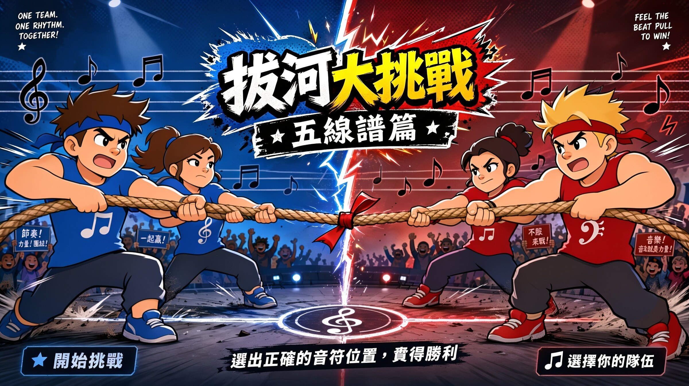

# 五線譜拔河賽

給音樂課的分組競賽遊戲。兩隊在**同一台大觸控螢幕**上**同時**搶答五線譜音名，答對就把繩子往自己這邊拉一格，先把繩子拉過界線、或時間到時領先的隊伍獲勝。

單一 HTML 檔案，不需安裝、不需連網（第一次開啟後即可離線使用），雙擊就能玩。

**線上試玩 → https://linyubert.github.io/music-tug-of-war/**



---

## 特色

**真正的同時作答**　用 Pointer Events 處理多點觸控，左右兩區各自追蹤自己的觸控點，沒有任何全域鎖。兩個學生同時按、甚至同一隊連按，都各自獨立生效，不會互相吃掉。

**記譜法正確**　譜號直接內嵌 Bravura（SMuFL 標準樂譜字型）的原始輪廓，不依賴系統字型。定位點就是 SMuFL 定義的錨點：G 譜號的螺旋圓心對準第二線 G4、F 譜號的兩點夾住第四線 F3。譜線粗細、符頭比例、加線長度全部依 SMuFL 比例推導，縮放時不會走樣。

**出題平均**　洗牌抽牌制，一副牌抽完才重洗，確保每個音都輪得到，不會某些音整場沒考到。

**答錯有教學價值**　答錯時會亮出正確答案讓學生看一眼，再自動換下一題；比賽結束後列出「這場最常答錯的音」，方便安排複習。

**拔河動畫**　依真實力學繪製：身體後仰約 35 度、雙腳蹬在身體前方、繩子貼髖部通過。得分方後仰猛拉並揚起塵土，失分方被拖著往前滑並留下鞋底刮痕。

---

## 怎麼用

1. 三個檔案放在同一個資料夾：`index.html`、`cover.jpg`、`hoory.mp3`
2. 雙擊 `index.html`
3. 首頁按「開始挑戰」直接開打，或按「選擇你的隊伍」先進設定頁
4. 建議按左上角的「全螢幕」

### 設定項目

| 項目 | 選項 |
| --- | --- |
| 譜號 | 高音譜號／低音譜號／兩者混合 |
| 音域 | 僅五線之內／含加線 |
| 比賽時間 | 1／2／3／5 分鐘 |
| 獲勝分差 | 6／8／10／12 分 |
| 作答鍵高度 | 0～36vh，配合螢幕尺寸與學生身高把按鈕整組往上抬 |
| 音效 | 最後十秒倒數聲與勝利歡呼，可全部靜音 |
| 隊名 | 兩隊各自命名 |

設定會存在瀏覽器裡，下次開啟自動沿用。

### 教室使用建議

- 兩個學生各站一邊，其他組員在後面看譜提示
- 「作答鍵高度」對低年級調高一點，孩子不用彎腰
- 初學班先用「高音譜號＋僅五線之內」（9 個音），熟了再加加線
- 用「獲勝分差 6 分」跑短局，一節課可以輪很多組

---

## 換掉音效或封面

- **歡呼聲**：把你的音檔命名為 `hoory.mp3` 放在同一資料夾即可。程式也會依序尋找 `hooray.mp3`、`hooray.wav`、`hooray.m4a`、`cheer.mp3`
- **封面**：換掉 `cover.jpg` 即可。若新圖比例不是 16:9，需同步調整 `index.html` 裡 `#stage` 的 `--sw` 與高度計算，以及封面按鈕的百分比位置

## 修改連結

`index.html` 裡搜尋 `const LINKS`：

```js
const LINKS = {
  threads: "https://www.threads.com/@lycbert",
  youtube: "https://www.youtube.com/@datoemusic"
};
```

---

## 技術

原生 HTML / CSS / JavaScript，零框架、零建置流程、零外部相依。五線譜與拔河場景都是即時產生的 SVG。

- 譜號與符頭輪廓取自 [Bravura](https://github.com/steinbergmedia/bravura)（SIL Open Font License 1.1）
- 音效以 Web Audio API 即時合成，不需額外音檔

## 授權

MIT License，詳見 [LICENSE](LICENSE)。歡迎其他老師自由使用與修改。
